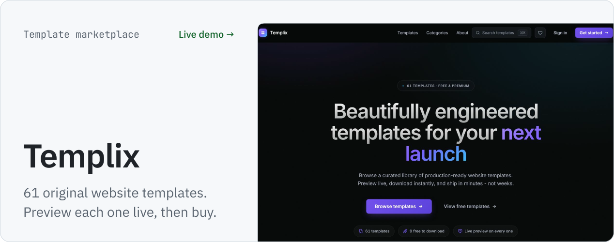
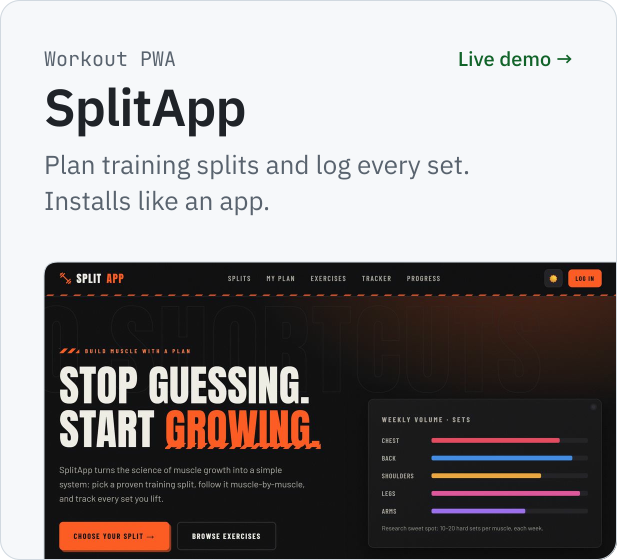

<picture><source media="(prefers-color-scheme: dark)" srcset="assets/hero-dark.svg"></picture>

I'm Waseem Abu Fares. I build complete web products end to end: React and TypeScript frontends, Supabase backends with Row-Level Security, Stripe payments, and AI features powered by the Claude API.

<a href="https://github.com/w4seemdev/w4seemdev/issues/new?title=Project%20inquiry"><picture><source media="(prefers-color-scheme: dark)" srcset="assets/cta-dark.svg"></picture></a>

## Selected work

<a href="https://templix-peach.vercel.app"><picture><source media="(prefers-color-scheme: dark)" srcset="assets/templix-dark.svg"></picture></a>

<a href="https://split-app-tawny.vercel.app"><picture><source media="(prefers-color-scheme: dark)" srcset="assets/splitapp-dark.svg"></picture></a><a href="https://zukunft-service.cloud/de"><picture><source media="(prefers-color-scheme: dark)" srcset="assets/zukunft-dark.svg"></picture></a>

### How they are built

- **Templix** ([live demo](https://templix-peach.vercel.app), [source](https://github.com/w4seemdev/Templix)): customers cannot tamper with prices or download without paying. The client sends only a template id, price and buyer identity are resolved server-side, and downloads are ownership-gated behind signed URLs. Built with React 19, TypeScript, Supabase and Stripe.
- **SplitApp** ([live demo](https://split-app-tawny.vercel.app), [source](https://github.com/w4seemdev/SplitApp)): sets logged mid-workout are never lost, even if the tab closes, because a debounced write-through to Supabase flushes automatically on close. Built with React 18, Vite, Supabase and Workbox.
- **Zukunft Service** ([live site](https://zukunft-service.cloud/de), [source](https://github.com/w4seemdev/GermanyApp)): a client site for a service agency in Dortmund, in German and Arabic. The Arabic layout is truly right to left, because a build check fails on any physical CSS direction, and Arabic has its own type scale. No cookies or trackers, and fonts are self-hosted. Built with Next.js 16, TypeScript and Tailwind CSS 4.

## AI, ML and automation

- **[YouTubeAnalysisProject](https://github.com/w4seemdev/YouTubeAnalysisProject)**: a trained XGBoost model with 15 engineered features, served by FastAPI with a React dashboard, from raw data to a working product.
- **[AiSpaceShortsAgent](https://github.com/w4seemdev/AiSpaceShortsAgent)**: an autonomous pipeline covering LLM script, TTS narration, word-synced captions and auto-upload, with no human in the loop.
- **[Auto-Fill-Forms](https://github.com/w4seemdev/Auto-Fill-Forms)**: a human-in-the-loop agent that fills the form while the human always clicks Submit, with prompt-injection defenses built in.

Also on my profile: [IDEAenhancer](https://github.com/w4seemdev/IDEAenhancer), an AI product concept generator built on structured outputs from the Claude API. [AiNews](https://github.com/w4seemdev/AiNews), a daily AI news site rebuilt by scheduled GitHub Actions. [DataDojo](https://github.com/w4seemdev/datadojo), a crowdsourced AI-training-data platform. [GameDashBoard](https://github.com/w4seemdev/GameDashBoard), a RAWG game discovery dashboard.

## What I can build for you

- **React and TypeScript web apps**: fast SPAs and installable PWAs with code splitting, accessibility and strict typing.
- **Supabase backends**: authentication, Postgres with Row-Level Security, storage and edge functions.
- **Payment flows**: secure Stripe checkout with server-side pricing and signature-verified webhook fulfilment.
- **AI features with the Claude API**: structured outputs, rate limiting, and graceful degradation when keys or quotas run out.

<kbd>React 19</kbd> <kbd>TypeScript</kbd> <kbd>Node.js</kbd> <kbd>Vite</kbd> <kbd>Tailwind CSS 4</kbd> <kbd>Supabase</kbd> <kbd>Claude API</kbd> <kbd>Python</kbd> <kbd>FastAPI</kbd> <kbd>Playwright</kbd> <kbd>Vitest</kbd> <kbd>GitHub Actions</kbd> <kbd>Vercel</kbd>

## Work with me

Clear milestones agreed up front, regular progress updates, and full source handover with documentation. I work in English and Arabic.

The fastest way to reach me is to [open a project inquiry](https://github.com/w4seemdev/w4seemdev/issues/new?title=Project%20inquiry). I reply on GitHub.

<!-- profile refreshed: 2026-11-12 -->
